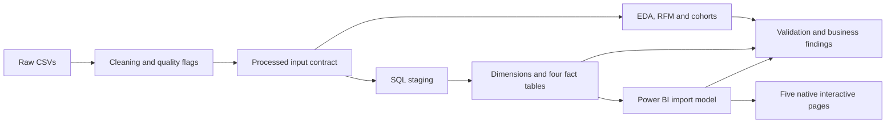
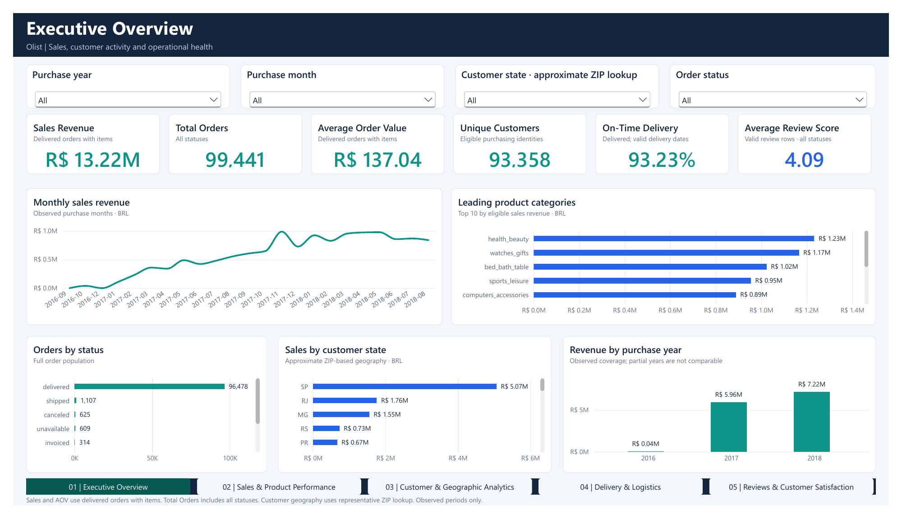
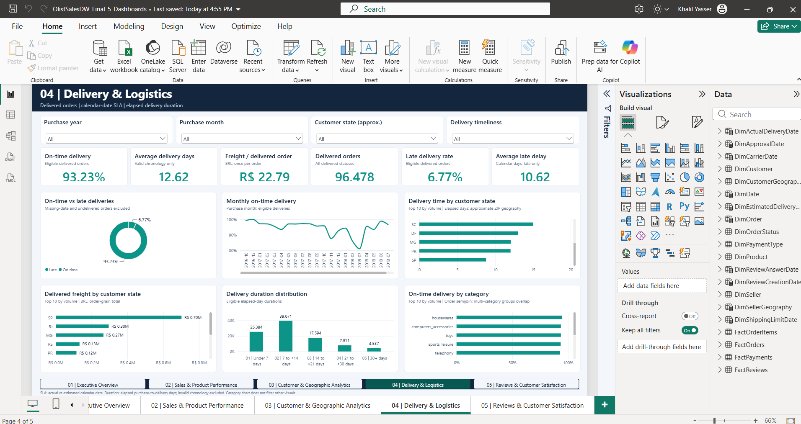

# Olist Sales Analytics & Business Intelligence

An end-to-end analytics project that transforms Brazilian marketplace transactions into a validated SQL Server warehouse, customer analysis and a five-page interactive Power BI report.

**Local delivery:** complete. The final PBIX was saved, closed and independently reopened. Its model passed 86 DAX cases and 39 dashboard query batches. Documentation and repository cleanup were completed on 6 November 2026; the underlying report acceptance was recorded on 2 November 2026.

[Documentation](docs/README.md) · [Dashboard guide](docs/dashboard_guide.md) · [Reproduction](docs/reproduction_guide.md) · [Validation](docs/validation.md) · [Business findings](docs/business_insights.md)

## Business context

Marketplace data combines orders, individual items, payment sequences and review records. These tables have different grains. A direct join can multiply money, shipping charges and ratings, producing attractive but incorrect dashboards.

This project answers five practical questions:

1. How much eligible merchandise was sold, and how did sales change over time?
2. Which products, categories and sellers contributed revenue?
3. How concentrated was purchasing, and how often did customers return?
4. Where were deliveries late, slow or expensive?
5. How did customer ratings vary with geography, review time and fulfillment outcomes?

## Validated snapshot

| Metric | Result | Population |
|---|---:|---|
| Orders | 99,441 | All source order statuses |
| Eligible sales orders | 96,478 | Delivered orders with recorded items |
| Merchandise sales | R$13,221,498.11 | Eligible items; freight excluded |
| Average sales order value | R$137.04 | Eligible merchandise / eligible orders |
| Purchasing identities | 93,358 | Distinct `customer_unique_id` in eligible sales |
| Repeat purchasing identities | 3.00028% | 2,801 customers with at least two eligible orders |
| On-time delivery | 93.2269% | 89,936 / 96,470 SLA-eligible orders |
| Average delivery duration | 12.6185 days | 95,097 orders with valid duration chronology |
| Average review score | 4.08642 / 5 | 99,224 valid review records across all statuses |

These populations deliberately differ. Read the [KPI dictionary](docs/kpi_definitions.md) before comparing metrics. Findings describe the historical dataset, not current Olist operations.

## Dataset and technology

The [Brazilian E-Commerce Public Dataset by Olist](https://www.kaggle.com/datasets/olistbr/brazilian-ecommerce) supplies nine raw CSVs: customers, orders, order items, payments, reviews, products, sellers, geolocation and category translations. Eligible purchases span 15 September 2016 to 29 August 2018. Dataset boundaries do not establish complete operating periods.

The project uses Python, pandas, NumPy, Matplotlib, seaborn, Jupyter and pytest; SQL Server, pyodbc and SQLAlchemy; and Power BI Desktop, DAX, TMDL and PBIR. Dependencies are recorded in [requirements.txt](requirements.txt). Attribution and redistribution boundaries are documented in [dataset attribution](docs/dataset_attribution.md).

## Architecture



The SQL warehouse preserves separate order, item, payment and review facts, decimal money and load lineage. Power BI uses a shared order dimension, separate customer/seller geography and explicit date roles. The final semantic model contains **31 tables, 37 relationships and 58 measures**. See [architecture](docs/architecture.md), [data dictionary](docs/data_dictionary.md) and [exact DAX reference](docs/dax_reference.md).

## Final report

| Page | Decision focus |
|---|---|
| 01 — Executive Overview | Sales, orders, customers and service indicators |
| 02 — Sales & Product Performance | Category, product and seller contribution |
| 03 — Customer & Geographic Analytics | Observed purchasing and geographic distribution |
| 04 — Delivery & Logistics | Delivery SLA, duration, late delay and freight |
| 05 — Reviews & Customer Satisfaction | Ratings, review volume and fulfillment associations |

The report contains **30 KPI cards, 29 charts/tables, 19 slicers and five page navigators** on 1600×900 pages. Visuals are native and editable.

- Local accepted binary: `power_bi/final/OlistSalesDW_Final_5_Dashboards.pbix` (retained locally; excluded from this repository).
- [Editable Power BI project](power_bi/final/OlistSalesDW_Final_5_Dashboards.pbip)
- [Native five-page PDF export](power_bi/final/OlistSalesDW_Final_5_Dashboards.pdf)





The [dashboard guide](docs/dashboard_guide.md) contains every page preview, the two final Desktop captures and filter instructions. Export previews and Desktop screenshots are identified separately.

## Customer analysis and business findings

Five executed notebooks cover understanding, cleaning, EDA, customer/RFM analysis and cohorts. Customer identity uses `customer_unique_id`; revenue uses eligible merchandise and exact cents. Cohorts use first observed eligible purchase, leave future periods blank and exclude the snapshot tail from pooled retention claims.

The top revenue categories are health & beauty, watches & gifts, and bed/bath/table. The highest-revenue tenth of customers contributes 41.0999% of eligible sales. Late-order reviews average 2.27103, compared with 4.28998 for on-time orders. These findings support investigation and controlled experiments; they do not establish causality, profit or campaign uplift. See [business insights](docs/business_insights.md) and [analysis methodology](docs/analysis_methodology.md).

## Validation

Recorded final acceptance includes 118 foundation tests passed with one explicit provenance/geography skip; 3,948 SQL/Python assertions; 86 runtime DAX cases with 248 numeric comparisons; 39 dashboard query batches; four exact Top-10 checks; and seven model regression checks. All five native-export pages were visually reviewed. Representative slicer, chart-selection and navigation behavior was reported working by the user.

Automated checks, visual inspection and user-reported UI evidence have different scopes. Historical tests are not represented as newly executed by the cleanup. The [validation report](docs/validation.md) links the retained machine-readable results and records the current cleanup checks.

## Get started

The GitHub edition includes code, five executed notebooks, aggregate results, the editable PBIP/PBIR/TMDL source, page images and the native PDF. Raw/processed CSVs, the imported PBIX and ABF cache remain local and are excluded by `.gitignore`. Download the dataset from the publisher and follow the reproduction guide to rebuild inputs and refresh the source model. Keep the PBIP with its sibling `.Report` and `.SemanticModel` folders.

For a GitHub checkout after installing the requirements:

```powershell
.\.venv\Scripts\python.exe -B scripts/validate_project.py --source-only
# After preparing the documented raw/processed inputs:
$env:PHASE2_AUDIT_WRITE = '0'
.\.venv\Scripts\python.exe -B -m pytest tests -q -p no:cacheprovider
```

Live SQL tests skip unless explicitly enabled. Environment setup, input verification, notebook execution, read-only SQL validation and Desktop DAX validation are explained in [reproduction](docs/reproduction_guide.md). Database setup and ETL are separate operations that modify the warehouse.

## Repository structure

```text
data/                Local raw/processed inputs and source manifest
notebooks/           Five executed analytical notebooks
src/                 Reusable cleaning, EDA, customer analytics and ETL
sql/                 Warehouse DDL, load, validation and schema diagram
tests/               Data, analytics, audit and ETL-safety checks
scripts/             Analysis generation and project/warehouse validation
power_bi/final/      Published PBIP source/PDF; PBIX/cache retained locally
power_bi/dashboards/  Page previews, Desktop captures and DAX queries
power_bi/scripts/     Read-only Desktop reconciliation utilities
power_bi/reports/     Retained baseline model for regression
reports/             Aggregate results, figures and selected test evidence
docs/                Maintained Markdown documentation
```

## Limitations and future work

ZIP-derived geography is approximate; original timestamp timezone provenance remains unverified. Snapshot boundaries censor customer activity. Some metrics are nonadditive across categories or states. Optional review text, missing child records and contradictory chronology have explicit handling. Scrollable report visuals expose more rows than static exports.

Power BI Service deployment, scheduled refresh, visual performance benchmarking and exhaustive filter combinations are not demonstrated. Future work could parameterize report connections and run service-level or repeat-purchase experiments using additional business data. Power BI Service deployment is outside the demonstrated scope.

Historical build copies, temporary fixtures and fragmented documentation were removed from the active project after a verified external backup. [Maintenance notes](docs/maintenance.md) describe the cleanup and recovery location.
