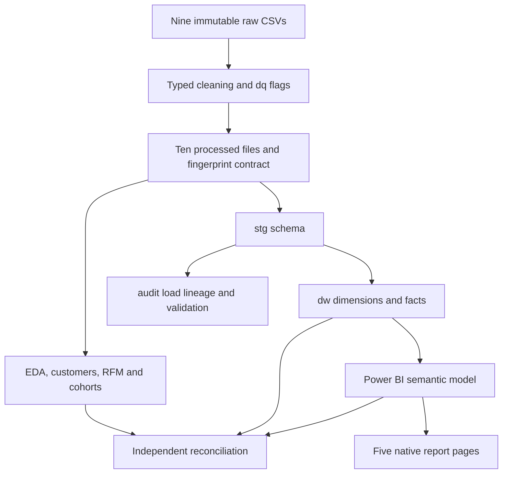

# Architecture and design decisions

## System boundaries

The project has four layers: preserved CSV inputs, Python preparation/analysis, a SQL Server warehouse and a Power BI import model. Reports and test evidence are derived outputs. The final PBIX contains an imported snapshot; viewing it does not require a database refresh.

## Data preparation

`src/data_processing/cleaning.py` reads source identifiers as strings, parses dates and numbers, preserves incomplete transactions and adds quality flags. It removes exact duplicate geographic observations from the processed copy and produces a deterministic one-row-per-ZIP lookup. It does not invent dates, financial values or translations.

`data/DATASET_MANIFEST.json` identifies the nine raw inputs. `src/data_processing/warehouse_contract.json` defines the ten processed filenames, row counts, hashes, keys, SQL staging types and nullability. `scripts/phase4/fingerprints.json` identifies all 19 input CSVs. See [data quality](data_quality.md).

## SQL warehouse

The warehouse is a fact constellation with seven reusable dimensions and four fact tables. Schemas separate `stg` ingestion, `dw` analytics and `audit` execution metadata. Surrogate key 0 represents an unknown dimension member. Monetary columns use decimal precision; missing order totals from absent item records remain NULL.

| Fact | Grain | Purpose |
|---|---|---|
| `FactOrders` | One `OrderID` | Orders, eligible populations, order totals and delivery |
| `FactOrderItems` | `OrderID` + `OrderItemID` | Merchandise, product, seller and item freight |
| `FactPayments` | `OrderID` + `PaymentSequential` | Recorded payment methods, installments and amounts |
| `FactReviews` | `ReviewID` + `OrderID` | Review records, scores and review dates |

Dimensions cover dates, geography, customers, products, sellers, order status and payment type. They describe source snapshots; the project does not invent slowly changing historical attributes. The [schema diagram](../sql/schema/olist_sales_dw.mmd), [column dictionary](data_dictionary.md) and [source mappings](../reports/phase_4_source_to_target_mapping.csv) define the implementation.

The Python ETL verifies ownership of `OlistSalesDW`, validates expected objects and controls the snapshot transaction. It stages typed inputs, loads dimensions/facts, checks reconciliation and records load lineage. SQL script 08 requires this Python-owned transaction and ownership marker. Repeated-load and rollback controls are tested; setup/loading remains a database-writing operation.

## Power BI semantic model

The accepted model has **31 tables, 37 single-direction relationships and 58 measures**. The 31 include date roles, helper tables and report-model extensions; they are not 31 warehouse business entities. The previous 33 measures, including the original 13, were preserved, and 25 measures were added for the final two pages.

`DimOrder` supplies a common order identity. `DimCustomerGeography` and `DimSellerGeography` separate geographic roles. Purchase, approval, carrier, actual/estimated delivery, shipping-limit, review-creation and review-answer dates have distinct roles. Month labels sort by month number; multi-year trends use year-month.

The BI model avoids direct fact-to-fact filter relationships, bidirectional filters, cycles and ambiguous directed paths. Physical SQL child-to-order foreign keys enforce integrity; they do not define the BI filter graph.

Product and seller selections naturally filter items. For category delivery/review charts, distinct order-category membership is explicitly transferred with `TREATAS`. Multi-category orders may contribute to several groups, so these counts are nonadditive. Enabling bidirectional filters would obscure this business definition.

Two calculated display columns classify delivery timeliness and elapsed-day bands. They extend the semantic model and do not change the SQL schema. Exact measure expressions are in [DAX reference](dax_reference.md).

## Analysis and verification

Python aggregates each child grain independently before combining order-level features. Customer analysis uses `customer_unique_id` and merchandise cents. SQL/Python checks provide independent expectations; Desktop DAX cases evaluate measures against those expectations. JSON report checks establish structure, while native export inspection and user-reported UI checks cover separate presentation/interaction concerns.

The saved final PBIX was closed and reopened before final runtime acceptance. Source folders, the report package and aggregate findings are fingerprinted for maintenance. See [validation](validation.md) for evidence and scope.

## Delivery and portability

The final PBIP lives beside its `.Report` and `.SemanticModel` directories. Its local ABF cache is retained to support the imported model snapshot. Machine-local editor settings and intermediate workspaces were removed. The cache and PBIX contain data and are ignored by Git.

SQL connections in ETL can be configured with environment variables. Existing Power BI source expressions retain local connection information; refresh on another machine requires adaptation in a working copy. Power BI Service deployment and scheduled refresh are outside the demonstrated local delivery.
