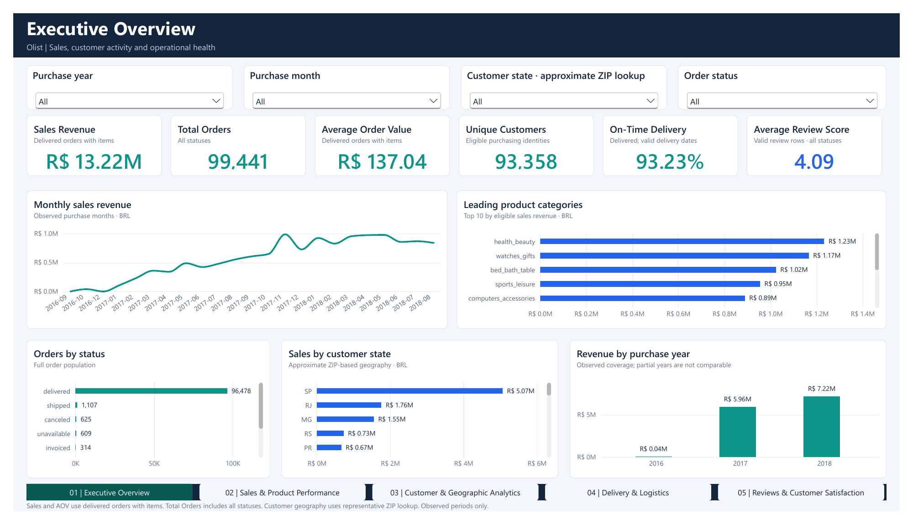
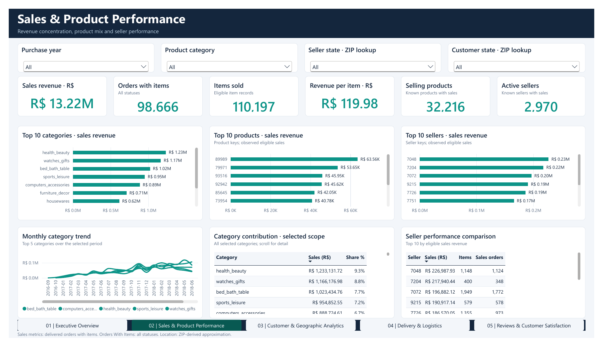
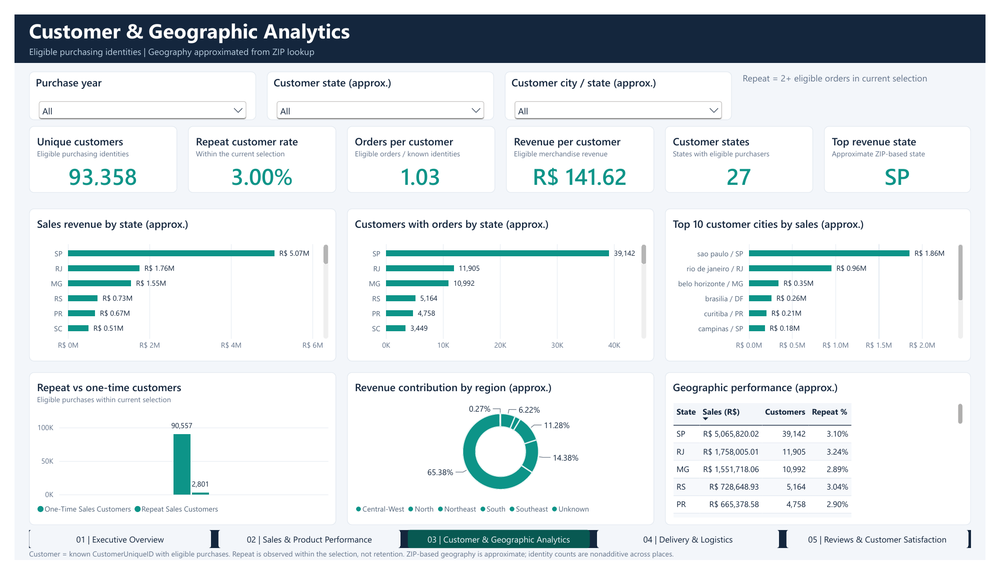
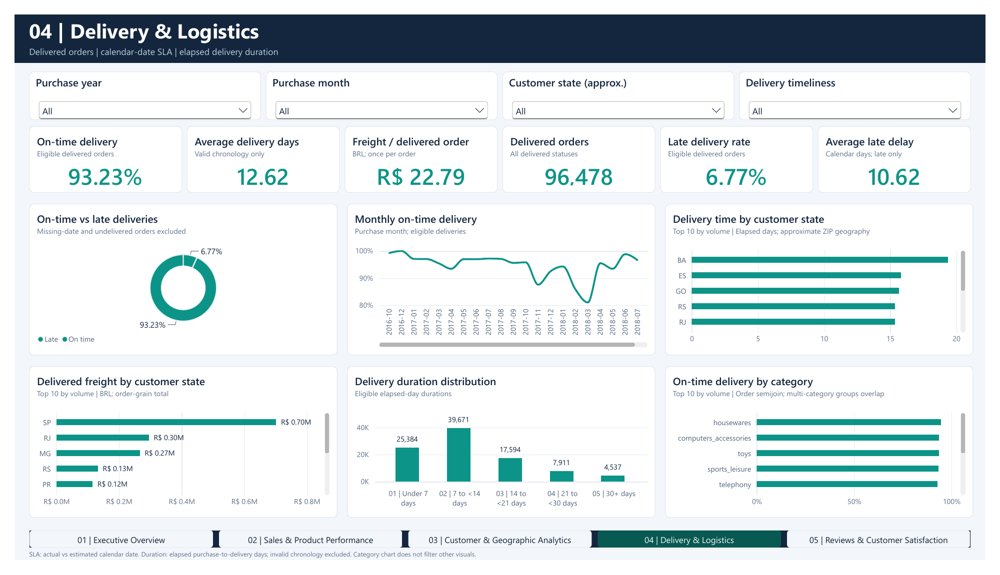
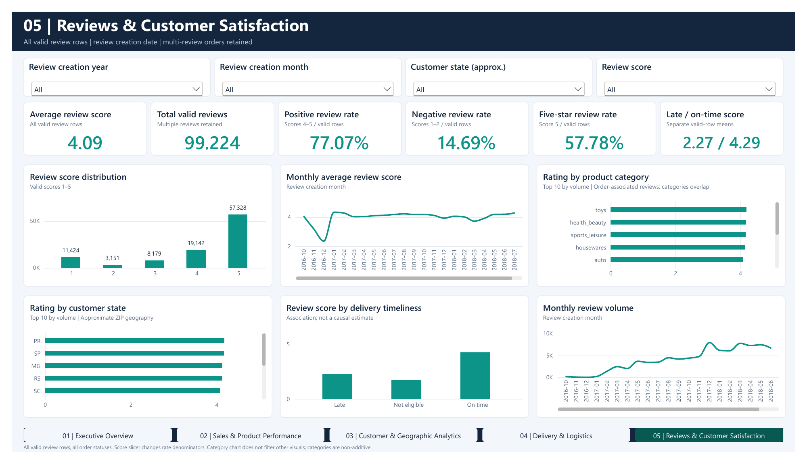
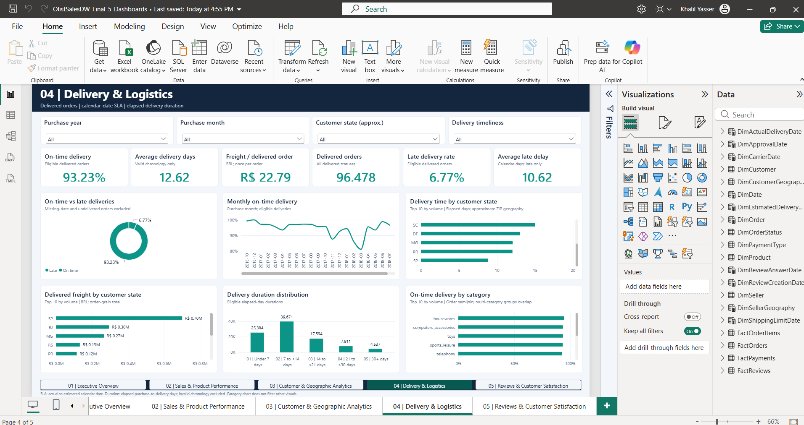
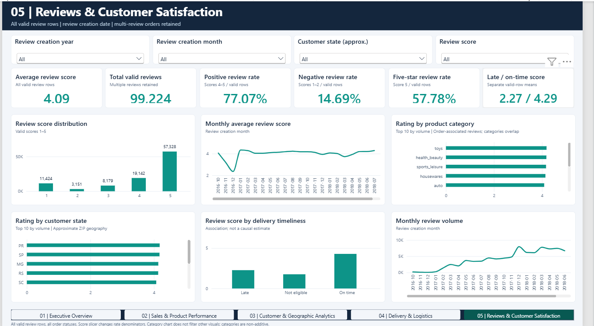

# Power BI dashboard guide

## Open the accepted report

The accepted local binary is `power_bi/final/OlistSalesDW_Final_5_Dashboards.pbix`, excluded from GitHub with the imported cache. Open it in Power BI Desktop when working from the full local delivery. It contains the imported snapshot and five native, editable pages. The [PBIP](../power_bi/final/OlistSalesDW_Final_5_Dashboards.pbip) is the editable source project; keep its sibling report/model directories together. The [PDF](../power_bi/final/OlistSalesDW_Final_5_Dashboards.pdf) is a static native export.

The report has 30 cards, 29 charts/tables, 19 slicers and five native page navigators. Pages are 1600×900. Viewing the local cached binary does not require SQL access. A GitHub checkout contains source and previews; reconstruct the inputs/warehouse and adapt the source connection before importing data.

## Page guide

| Page | Business questions | Context and cautions |
|---|---|---|
| 01 — Executive Overview | What is the revenue scale, order/customer profile and service performance? | Purchase context and customer geography; cards retain their distinct KPI populations |
| 02 — Sales & Product Performance | Which categories, products and sellers contribute eligible merchandise? | Item grain; product and seller filters reach supported item measures |
| 03 — Customer & Geographic Analytics | Where do customers buy, and how frequently do identities repeat? | `CustomerUniqueID`, selected period and approximate customer geography |
| 04 — Delivery & Logistics | Which deliveries miss SLA, take longer or carry more freight? | Order grain; purchase year/month, customer state and delivery status |
| 05 — Reviews & Customer Satisfaction | How do rating mix, review volume and fulfillment associations vary? | Review-record grain; review-creation year/month, customer state and score |

Delivery has six cards: on-time rate, average duration, average freight per delivered order, delivered orders, late rate and average late delay. Its charts cover timeliness mix/trend, state duration/freight, duration bands and category SLA.

Reviews has six cards covering average score, valid volume, positive/negative/five-star mix and the late/on-time comparison. Its charts cover score distribution, monthly score, category/state ratings, timeliness association and review volume.

## Using filters and navigation

1. Start with cleared slicers and inspect the baseline KPI populations.
2. Select the appropriate year/month; the Reviews page uses review creation time, while Delivery uses purchase time.
3. Add state, category or score selections supported by that page.
4. Select a chart group to inspect its configured interaction, then select again or clear it to reset.
5. Use the slicer eraser/clear control to restore the full population.
6. Move with tabs or the native navigator. Desktop editing mode may require **Ctrl+click** on navigation buttons.

Scrollable tables and Top-N charts may contain rows beyond the visible export viewport. Blank rates can represent an empty valid denominator. Money uses BRL formatting; duration uses elapsed days and late delay uses calendar days.

Product/category selection does not automatically restrict every order/review measure. The model avoids generic bidirectional filtering. Category delivery/review charts use explicit distinct-order attribution and intentionally do not filter other visuals. Their state/category groups are volume-ranked Top 10 with alphabetical tie-breaking. Read [KPI definitions](kpi_definitions.md) before adding categories or averaging rates.

## Representative interaction check

On Reviews, select score **1**: Positive should be **0%**, Negative **100%**, and Five-star **0%**. Clear it, select the score **5** chart bar and inspect configured card responses, then deselect. Test navigation between Delivery and Reviews. Clear all selections before saving a presentation baseline.

This representative flow was reported working by the user during final acceptance. It is not automated instrumentation or proof of every possible filter combination.

## Final-page previews

The following five images are rendered from the **actual final native Power BI PDF export**. They are report previews, rather than Desktop window screenshots.

### Executive Overview

### Sales & Product Performance

### Customer & Geographic Analytics

### Delivery & Logistics

### Reviews & Customer Satisfaction

## Actual Desktop captures

These two images were captured by the user in the reopened final report and visually verified. Delivery shows the application window; Reviews shows the report-canvas region. They were copied unchanged. [Capture evidence](../reports/completion_20261101/desktop_screenshots_20261102.json) records dimensions and hashes.

The `screenshot.png` files for pages 01–03 belong to the previously accepted three-page report. They remain as baseline assets and are not presented as final five-page Desktop captures.

## Editing and release

Work on a copy, preserve the imported cache with the PBIP when offline use matters, and keep one writer for report edits. Validate measures and source structure, save through Desktop, close/reopen and repeat representative checks. Do not merge PBIX binaries.

Existing source partitions include local connection settings. Change them in a working copy before a refresh on another machine. Local acceptance does not demonstrate Power BI Service deployment, scheduled refresh or full visual-performance benchmarking. See [validation](validation.md) and [maintenance](maintenance.md).
